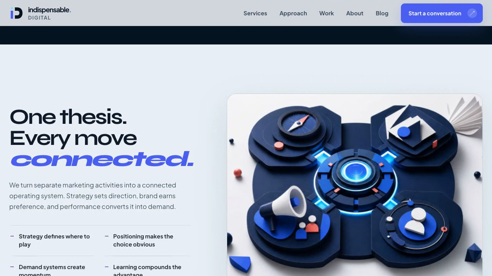
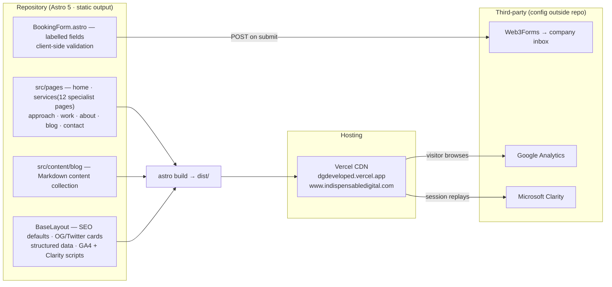

# Indispensable Digital

> An independent growth consultancy aligning strategy, positioning and performance so ambitious brands become understood, preferred and chosen.

[View the latest website](https://dgdeveloped.vercel.app/) · [Visit the primary domain](https://www.indispensabledigital.com/) · [Start a conversation](https://dgdeveloped.vercel.app/contact/#book-call)

> **🌐 Where the panel is right now:** this is internship project 2 of 3, presented by **Deepak Gangwar** (B.Tech IT, SRMS CET Bareilly; mentor: **Mr. Gaurav Gangwar**). It is the **public source of the deployed live site** — the private mirror `dgexplores/Indispensable-Digital` feeds the Vercel deployment and stays private. Customer enquiries, business correspondence, access keys and analytics raw data stay out of version control — they are **confidential to the company**, in every configuration or export.

---

## 🎬 Demo video — what it is & how to use it

<p align="center">
  <a href="https://github.com/dgexplores/Indispensable-Digital-Site/blob/main/docs/demo_indispensable.mp4">
    
  </a>
  <br><sub>▶ <b>Click the poster</b> to play the 34-second demo in GitHub's built-in player — or download the <a href="https://github.com/dgexplores/Indispensable-Digital-Site/raw/main/docs/demo_indispensable.mp4">raw mp4</a> (1.4 MB)</sub>
</p>

*(Recorded screen capture of the **real deployed site** — no mockups, no AI-generated UI. The strategy-call form is never actually submitted in the video; enquiries land in the company inbox via Web3Forms.)*

**Timeline of the video (captions are on-screen):**

| Caption | What you are seeing |
|---|---|
| Indispensable Digital — live production site | Landing hero: *"Make your brand the default."* + primary CTA |
| 01 · One thesis | *"Strategy, brand & performance, connected"* — the connected operating-system story band |
| 02 · Services | *"Eight disciplines, one outcome: market leadership"* — the full service architecture |
| 03 · Approach | Strategy → Story → Growth → Impact, the senior-led method |
| 04 · Ways to work | Growth Diagnostic · Brand & Positioning Sprint · Fractional Growth Partner |
| 05–06 · Contact | Booking-form tour: client-side validation; submits via Web3Forms to the company inbox (not demonstrated live) |

**How a visitor uses it (30 seconds):**
1. Open [https://dgdeveloped.vercel.app](https://dgdeveloped.vercel.app/) — positioning and proof land before the fold.
2. Move through **Services →** every capability page, **Approach** → the working method, **Work** → engagement options, **Insights** → articles.
3. Hit **Start a conversation** → the booking form validates in the browser and emails through Web3Forms — no database, no spam exposure.
4. Mobile-resize anytime: the design system (Signal Intelligence) re-flows with reduced-motion fallbacks intact.

## 🧭 How the site works (architecture)



**Key technical points:**
- **Fully static at build time** — zero first-party backend, no database, no auth: attack surface is small and hosting is cheap/fast.
- **Enquiries never touch a repo server** — `BookingForm.astro` posts to Web3Forms; nothing is stored in Git or a first-party DB.
- **SEO-complete** — unique titles/descriptions, canonical URLs, Organization/FAQ/Service structured data, auto sitemap, `robots.txt` + `llms.txt`, 1200×630 social image.
- **Design system "Signal Intelligence"** — Syne / Plus Jakarta Sans / IBM Plex Mono, signal-path motif, reduced-motion + keyboard-focus fallbacks.

## ✅ Capabilities (as of now)

| Area | Status |
|---|---|
| Multi-page responsive site (home · services + 12 specialist pages · approach · work · about · insights · contact · legal pages) | ✅ live |
| Strategy-call enquiry: browser validation → Web3Forms email delivery | ✅ live |
| SEO suite (titles · canonical · OG/Twitter · structured data · sitemap · robots.txt · llms.txt · social image) | ✅ live |
| Analytics: GA4 + Microsoft Clarity | ✅ live |
| AEO answer-engine visibility (`llms.txt`, semantic crawlable static HTML) | ✅ live |
| Blog publishing workflow (content collections + build validation) | ✅ documented & used |
| Reduced-motion, focus states, responsive breakpoints | ✅ in code |
| Enquiry storage / CRM integration | ❌ by design — future work (form emails directly) |
| Auto-deploy on push | ⚙️ manual checklist flow — GitHub→Vercel connection documented in the handbook below |

## 🙋 FAQ — questions the presentation panel may ask

**Q. What did you actually do on this site?**
> Front-end depth during the internship: responsive layout work, form accessibility and validation behaviour, SEO wiring (titles, canonical, structured data, sitemap/robots), and the owner/developer handbook that this README carries. The site runs live in production on Vercel with the company's domain.

**Q. Why Astro and not React/Next?**
> It is a content-heavy marketing site that ships mostly HTML. Astro gives multi-route static output with near-zero client JavaScript by default — fast LCP, clean SEO — and Web3Forms removes the need for a backend, so a heavier framework would add cost with no benefit.

**Q. Where do contact-form submissions go?**
> `BookingForm.astro` validates in the browser and posts to Web3Forms; submissions arrive at the company's configured inbox. No database, no first-party storage — the access key and inbox are held outside this repo.

**Q. Why are the GA/Clarity IDs visible in the README?**
> Measurement IDs are client-side by design and public in the page source of every deployed page; they are not secrets. The confidential parts — Web3Forms access key, the receiving inbox, customer enquiries and analytics exports — are never committed.

**Q. Why two repositories — private and public?**
> The private mirror `Indispensable-Digital` stays attached to the Vercel deployment; this public repo (`-Site`) is the showcase copy with the same history. Documentation links here point only to the public one so anyone can clone and run it.

**Q. Is this actually in production?**
> Yes — deployed on Vercel, serving `www.indispensabledigital.com` with legal pages, analytics and the full SEO bundle. Of the three internship projects, this is the one closest to production reality.

**Q. What would you add next?**
> GitHub→Vercel auto-deploy tightening, enquiry → CRM handoff, CMS-driven content updates for non-technical editors, and continued AEO experiments — all listed in the pre-launch checklist below.

---

## About the business

Indispensable Digital works with founders and leadership teams that want to become the default choice in their category. Instead of treating strategy, brand, content and acquisition as separate activities, the consultancy connects them into one accountable growth system.

The work is senior-led from diagnosis through execution and is measured against commercial outcomes such as qualified demand, pipeline, revenue and market position.

### Who we serve

- Founder-led and growth-stage businesses
- Consumer, ecommerce and D2C brands
- Creators and authority-led businesses
- Leadership teams that need senior strategy alongside hands-on execution
- Brands ready to build a durable category position rather than run isolated campaigns

## What we do

| Capability | What it delivers |
|---|---|
| Growth Strategy | A commercial roadmap defining where to play, how to win and which moves should happen next. |
| Brand Positioning | A clear, defensible category position and narrative that make the brand easier to understand and choose. |
| PR & Communications | Earned authority and communication systems that improve trust and market perception. |
| Content Strategy | Content that educates, converts and compounds category ownership. |
| YouTube Growth | Owned-audience systems that turn attention into durable authority and demand. |
| Google Ads | Search, Shopping, Performance Max and Display campaigns managed around profitable demand. |
| Meta Ads | Facebook and Instagram acquisition systems designed for qualified leads and sales. |
| AEO & SEO | Technical SEO, on-page SEO and visibility for search engines and AI answer engines. |
| Ecommerce Marketing | Full-funnel acquisition and retention strategy for ecommerce and D2C businesses. |
| Web Development | Conversion-focused custom, Shopify and WordPress website experiences. |
| Conversion Rate Optimization | Evidence-led improvements that convert more existing traffic. |
| Analytics | GA4, Google Tag Manager and measurement infrastructure for better decisions. |

### Ways to work together

1. **Growth Diagnostic** — an audit of positioning, funnel and market constraints to identify the highest-leverage opportunities.
2. **Brand & Positioning Sprint** — a focused engagement to define the category position, narrative and strategic foundation.
3. **Fractional Growth Partner** — an ongoing senior partnership covering strategy, execution and continuous learning.

## Website preview

The Vercel URL contains the latest approved redesign.

- **Latest production deployment:** [dgdeveloped.vercel.app](https://dgdeveloped.vercel.app/)
- **Primary brand domain:** [www.indispensabledigital.com](https://www.indispensabledigital.com/)
- **GitHub repository (public):** [dgexplores/Indispensable-Digital-Site](https://github.com/dgexplores/Indispensable-Digital-Site)

### Website tour

| Page | Purpose |
|---|---|
| [Home](https://dgdeveloped.vercel.app/) | Positioning, operating philosophy, capabilities and primary calls to action. |
| [Services](https://dgdeveloped.vercel.app/services/) | Complete service overview and links to every specialist service page. |
| [Approach](https://dgdeveloped.vercel.app/approach/) | The Strategy, Story, Growth and Impact engagement method. |
| [Ways to Work](https://dgdeveloped.vercel.app/work/) | Growth Diagnostic, Positioning Sprint and Fractional Growth Partner options. |
| [About](https://dgdeveloped.vercel.app/about/) | Founder background and consultancy philosophy. |
| [Insights](https://dgdeveloped.vercel.app/blog/) | Articles and case studies covering growth, paid media, SEO and AEO. |
| [Contact](https://dgdeveloped.vercel.app/contact/) | Contact details and strategy-call enquiry form. |

---

# Owner and developer handbook

This section explains how to access, update, verify and deploy the website.

## Current technical setup

| Area | Implementation |
|---|---|
| Framework | [Astro](https://astro.build) 5 |
| Rendering | Static HTML generated at build time |
| Styling and motion | Shared CSS design and motion system |
| Hosting | Vercel production deployment |
| Source control | GitHub, `main` branch |
| Contact form | Web3Forms, submitted directly from the visitor's browser |
| Analytics | Google Analytics and Microsoft Clarity |
| Database | None |
| Authentication | None |
| First-party backend | None |

This architecture is appropriate for a fast marketing website. Contact enquiries are emailed through Web3Forms and are not stored in a database owned by this repository.

## Run the site locally

### Requirements

- Node.js 20 or newer
- npm
- Git

### First-time setup

```bash
git clone https://github.com/dgexplores/Indispensable-Digital-Site.git
cd Indispensable-Digital-Site
npm install
npm run dev
```

Open [http://localhost:4321](http://localhost:4321/) to view the development server. Changes update automatically while it is running.

### Verify the production build

```bash
npm run build
npm run preview
```

The static production output is generated in `dist/`. Always run `npm run build` before publishing meaningful changes.

## Common commands

| Command | Purpose |
|---|---|
| `npm install` | Install project dependencies. |
| `npm run dev` | Start the local development server. |
| `npm run build` | Generate the production site in `dist/`. |
| `npm run preview` | Preview the generated production build locally. |

## Where to update content

| Content | Location |
|---|---|
| Homepage | `src/pages/index.astro` |
| Main services page | `src/pages/services.astro` |
| Individual service pages | `src/pages/services/` |
| Approach | `src/pages/approach.astro` |
| Engagement models | `src/pages/work.astro` |
| Founder and company information | `src/pages/about.astro` |
| Contact page | `src/pages/contact.astro` |
| Contact form | `src/components/BookingForm.astro` |
| Blog articles | `src/content/blog/` |
| Header and navigation | `src/components/Header.astro` |
| Footer and contact links | `src/components/Footer.astro` |
| Reusable calls to action | `src/components/CtaSection.astro` |
| Global styles and animations | `src/styles/global.css` |
| Images, favicon and social assets | `public/` |
| SEO defaults and analytics scripts | `src/layouts/BaseLayout.astro` |
| Canonical site URL and sitemap | `astro.config.mjs` |

## Adding a blog article

1. Add a Markdown file to `src/content/blog/`.
2. Follow the frontmatter structure used by the existing articles.
3. Use a descriptive lowercase filename because it becomes the article URL.
4. Run `npm run build` to validate the content collection and generated route.
5. Review the article on desktop and mobile before publishing.

## Contact form and visitor data

The strategy-call form posts to Web3Forms from `src/components/BookingForm.astro`.

- The form validates name, email, phone and message fields in the browser.
- Successful submissions are delivered to the email account associated with the Web3Forms access key.
- Submissions are not saved in this repository or a first-party database.
- The form displays success and failure feedback to the visitor.
- A direct email address remains visible as a fallback.

Before a major launch, submit one labelled test enquiry and confirm that it reaches the intended inbox. If the form stops working, verify the Web3Forms account, access key and receiving email before changing the frontend.

Do not commit exported enquiries, customer information, passwords, private API tokens or analytics credentials to GitHub.

## Analytics and tracking

The shared layout currently loads:

- Google Analytics measurement ID `G-0HF33W0NR0`
- Microsoft Clarity project ID `xi2iuhve29`

The scripts are configured in `src/layouts/BaseLayout.astro`. Confirm data collection inside the corresponding Google Analytics and Microsoft Clarity dashboards after production changes. Avoid creating duplicate tracking tags through another tag manager or hosting integration.

## SEO and discoverability

The website includes:

- Unique page titles and descriptions
- Canonical URLs
- Open Graph and Twitter Card metadata
- Organization, Website, WebPage, FAQ and service structured data
- Automatically generated XML sitemap
- `robots.txt` and `llms.txt`
- Semantic HTML and crawlable static output
- A 1200 × 630 social-sharing image

The canonical domain is configured as `https://www.indispensabledigital.com` in `astro.config.mjs`. If the primary domain changes, update that value and search the repository for existing absolute URLs before deployment.

## Design system

The website uses the **Signal Intelligence** identity:

- Syne for display typography
- Plus Jakarta Sans for body copy
- IBM Plex Mono for utility labels
- Midnight, cobalt, cyan, porcelain and coral color accents
- A signal-path visual motif
- Editorial grids, visual-story illustrations and data-led compositions
- Route transitions, marquees, scroll reveals, parallax and responsive motion

Motion includes reduced-motion fallbacks, and interactive controls include visible keyboard-focus treatment. Maintain these accessibility behaviors when changing animations.

## Deployment

### Current production

- **Vercel URL:** [dgdeveloped.vercel.app](https://dgdeveloped.vercel.app/)
- **Production branch:** `main`
- **Build command:** `npm run build`
- **Output directory:** `dist`

The repository does not currently contain a `.vercel/project.json` link file. Do not assume that every GitHub push automatically redeploys Vercel. To enable automatic deployments, connect the GitHub repository to the `dgdeveloped` project in Vercel and select `main` as the production branch.

### Recommended publishing workflow

1. Create a short feature branch.
2. Make and review the changes locally.
3. Run `npm run build`.
4. Commit and push the feature branch.
5. Merge the reviewed change into `main`.
6. Confirm that Vercel has produced a READY deployment.
7. Check the homepage, contact page, navigation, images and form on desktop and mobile.
8. Confirm analytics and enquiry delivery when those systems were changed.

## Mandatory pre-launch checklist

- [ ] Production build completes without errors.
- [ ] All navigation links and service pages open correctly.
- [ ] Homepage and contact page are checked on desktop and mobile.
- [ ] Contact form validation works and a labelled test reaches the correct inbox.
- [ ] Email address, phone number and social links are current.
- [ ] Canonical domain, sitemap and `robots.txt` use the intended production domain.
- [ ] Page titles, descriptions and social preview image are correct.
- [ ] Privacy Policy and Terms & Conditions reflect current business practices.
- [ ] Google Analytics and Microsoft Clarity receive production traffic.
- [ ] No private keys, customer data or credentials are present in the commit.
- [ ] Vercel deployment status is READY and important assets return successfully.

## Legal and operational pages

- [Privacy Policy](https://dgdeveloped.vercel.app/privacy-policy/)
- [Terms & Conditions](https://dgdeveloped.vercel.app/terms-and-conditions/)
- [Contact](https://dgdeveloped.vercel.app/contact/)

These pages are operational templates and should be reviewed by a qualified legal professional whenever services, tracking, data handling, jurisdictions or contact details change.

## Business contact

- **Email:** [contact@indispensabledigital.com](mailto:contact@indispensabledigital.com)
- **Phone:** [+91-7000123171](tel:+917000123171)
- **LinkedIn:** [Indispensable Digital](https://www.linkedin.com/company/indispensabledigital/)
- **Instagram:** [@indispensabledigital_](https://www.instagram.com/indispensabledigital_/)
- **Location:** New Delhi, India — working worldwide
